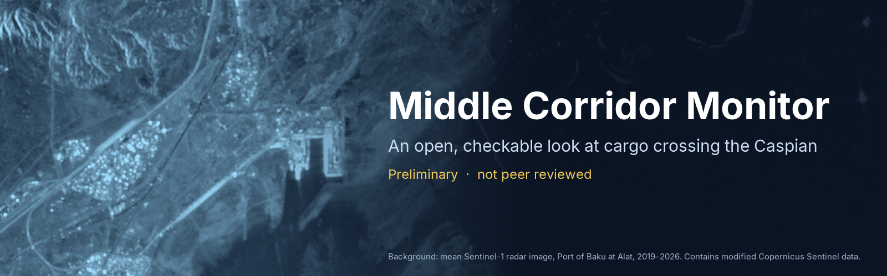
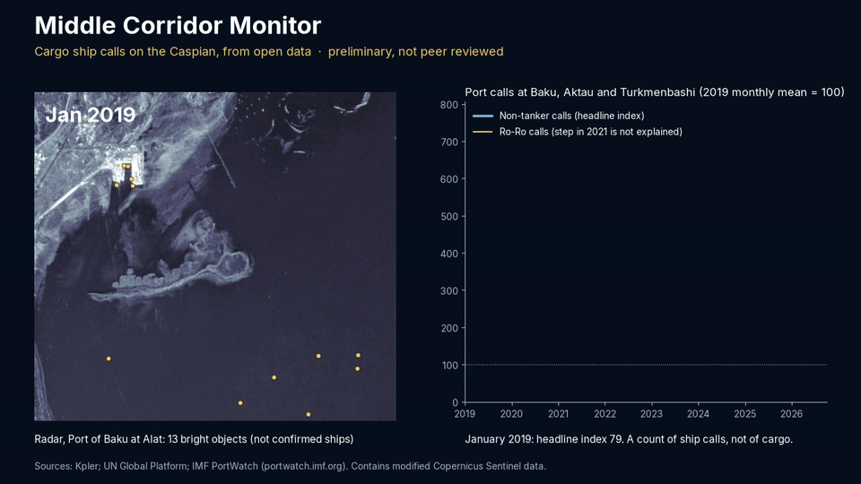
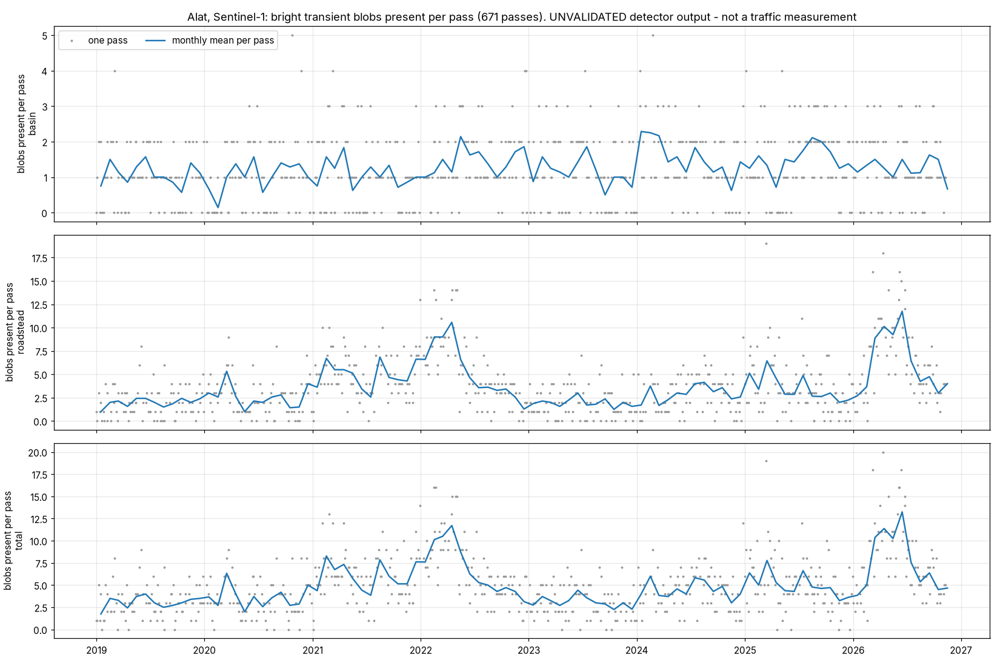
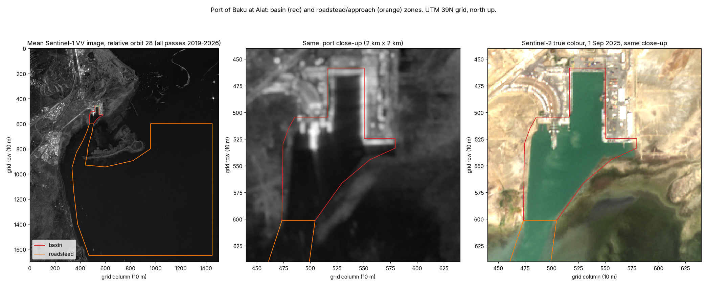

# Middle Corridor Monitor

Status: **public draft.** Preliminary. Not peer reviewed. Page: https://aghasalim.github.io/middle-corridor-monitor/

Authors: Aghasalim Mustafazada (Howest University of Applied Sciences, Belgium); Teymur Eyvazov (University of Massachusetts Boston, USA)



One frame per month. Left: the mean Sentinel-1 radar image of the Port of Baku at Alat with that month's
radar detections. They are bright objects on the water, not confirmed ships. Right: the index up to that
month. The video is drawn by `research/video.py` from the data in this repository
([MP4 version](docs/monitor.mp4)).

## The question

How much cargo crosses the Caspian Sea on the Middle Corridor? The official figures do not agree. For 2025
the Kazakh Ministry of Transport reports 4.119 million tonnes on the route, and the route association's own
chart shows 1.867 million tonnes. The international reports we read take their volumes from operators,
railways, port authorities, surveys or models. None of them uses ship-tracking or satellite data, so the
official figures have no independent check. This project tests whether open data can provide one.

## What we found so far

The results are mostly negative. The numbers below are from `paper/paper.pdf`; where each comes from is in
`paper/NUMBERS.md`.

| Question | Result |
|---|---|
| Does the index follow the ministry's route total? | No. Year-on-year correlation -0.05 (n = 6). |
| Does PortWatch tonnage forecast Aktau's monthly cargo? | No. It loses to two naive forecasts. |
| Where does PortWatch agree with official data? | Vessel-call levels and oil tonnage at Aktau. Not year-on-year changes in calls. |
| How much dry cargo does it see at Baku? | About 12% of the official total. |
| Is the fourfold rise in Ro-Ro calls from 2021 to 2022 real? | Not on the evidence. Official ferry statistics for Kuryk show +50% in calls and +87% in tonnes. The cause is not confirmed. |
| What is missing? | Kuryk, with 18% to 30% of Kazakh seaport cargo (one year is in doubt), is not in PortWatch. |
| Does radar confirm the counts? | Not yet. 3,333 objects in 671 passes at Alat, none labelled by hand. |




## Who did what

- Aghasalim Mustafazada (third-year bachelor student, Creative Technologies & AI, Howest, Belgium):
  Sentinel-1 radar detection, hand-labelling kit, project page, images and video.
- Teymur Eyvazov (University of Massachusetts Boston, USA): index, statistics, validation against official figures.

## Purpose

An open, monthly, independently checkable measure of cargo crossing the Caspian leg of the
Middle Corridor. The headline series is the monthly count of non-tanker port calls (container,
dry bulk, general cargo, Ro-Ro) at Baku, Aktau and Turkmenbashi, indexed to the 2019 monthly
mean = 100. Ro-Ro calls, tanker calls, PortWatch dry tonnage and a Black Sea comparator
(Poti + Batumi) are reported alongside it.


The index is a count of ship calls, not of cargo. In our checks it does **not** track the official
Trans-Caspian route total year on year (see Limitations and `paper/paper.pdf`).



All images in this repository are produced by its code from satellite or port-call data. None is an
illustration. Radar and optical images contain modified Copernicus Sentinel data.

## Data sources

- IMF PortWatch daily port data (ArcGIS feature service `Daily_Ports_Data`), ports Baku
  (port100), Aktau (port16), Turkmenbashi (port1330), Poti (port1016), Batumi (port127).
  Sources: Kpler; UN Global Platform; IMF PortWatch (portwatch.imf.org).
- Official figures for validation (Port of Baku, Kazakh seaports, TITR route) in
  `data/official/official_figures.csv`, each row with its source URL and date.

The download date and the first/last day per port are in `data/portwatch/snapshot.json`.

## How to reproduce

```
python -m venv .venv
.venv/Scripts/python -m pip install -r requirements.txt
.venv/Scripts/python -m pip install -e .
.venv/Scripts/python -m mcm.build            # downloads PortWatch, then builds everything
.venv/Scripts/python -m mcm.build --offline  # reuses data/portwatch/
.venv/Scripts/python -m pytest -q
.venv/Scripts/python research/paper_checks.py   # extra numbers quoted in the paper
.venv/Scripts/python paper/build_pdf.py          # paper.md -> paper.pdf (needs Chrome)
```

(On macOS/Linux use `.venv/bin/python`.) The build fails loudly if a port's download is short,
has a duplicated day or a missing day.

The video and the title image are rebuilt with `research/video.py` (needs ffmpeg) and `research/banner.py`.

## Limitations

- Kuryk, Kazakhstan's ferry port, is not in PortWatch, so it is missing from the index.
- The boundary of PortWatch's "Baku Port" is not published; whether it includes Alat is unknown.
- Ferry cargo is poorly captured: rail ferries may not be classed as Ro-Ro, and PortWatch
  dry-cargo tonnage at Baku is several times below official figures.
- Ro-Ro calls step up four- to sixfold between 2021 and 2022 at all three Caspian ports at once.
  This is not explained (see `outputs/tables/index_roro_step.csv` and `outputs/figures/index_roro_step.png`).
- Sentinel-1 radar detections at Alat exist (`research/SAR_METHOD.md`, `outputs/tables/sar_*.csv`) but are
  unlabelled bright blobs, not confirmed ships. Precision and recall are unknown until the sample in
  `data/sar/label_sample.csv` is labelled by hand.
- In checks against official figures the index does not track the official Trans-Caspian route total year on
  year and does not forecast Kazakhstan's monthly sea-cargo series (`outputs/tables/validate_*.csv`).
- Port calls are counted, not tonnes or containers; a call by a large ship and a small one count the same.

## Licence

- Code: MIT, see `LICENSE`.
- Text, figures, tables, the video and the paper: CC BY 4.0 (https://creativecommons.org/licenses/by/4.0/).
- Third-party data keep their own terms. `data/portwatch/` is a copy of public IMF PortWatch data and must be
  cited as: Sources: Kpler; UN Global Platform; IMF PortWatch (portwatch.imf.org). Radar and optical images
  contain modified Copernicus Sentinel data. The figures in `data/official/` belong to the bodies that
  published them; each row gives its source.
