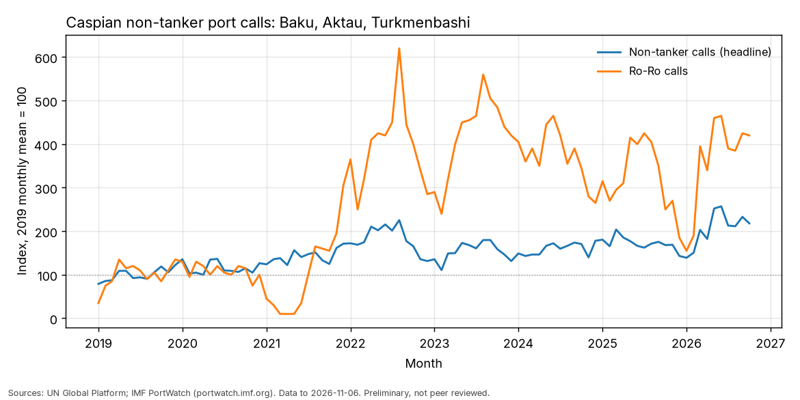
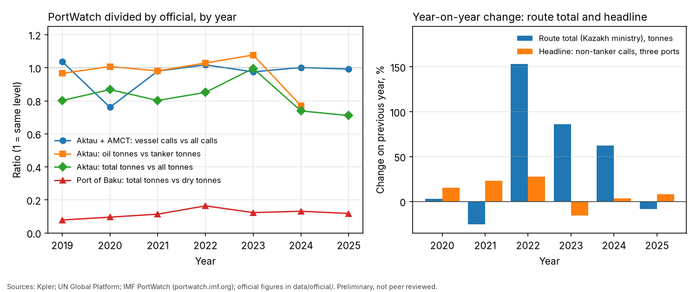
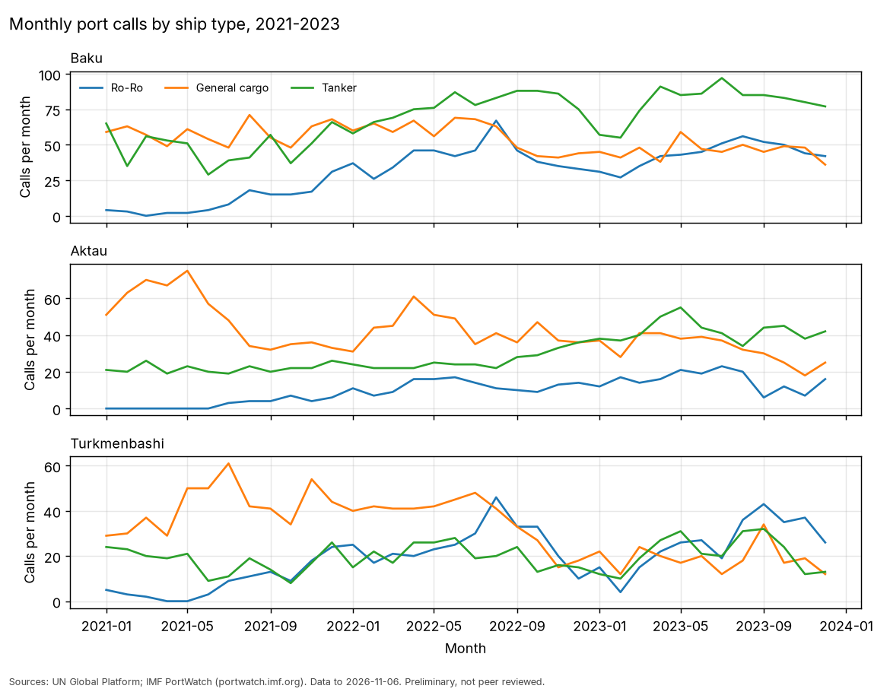
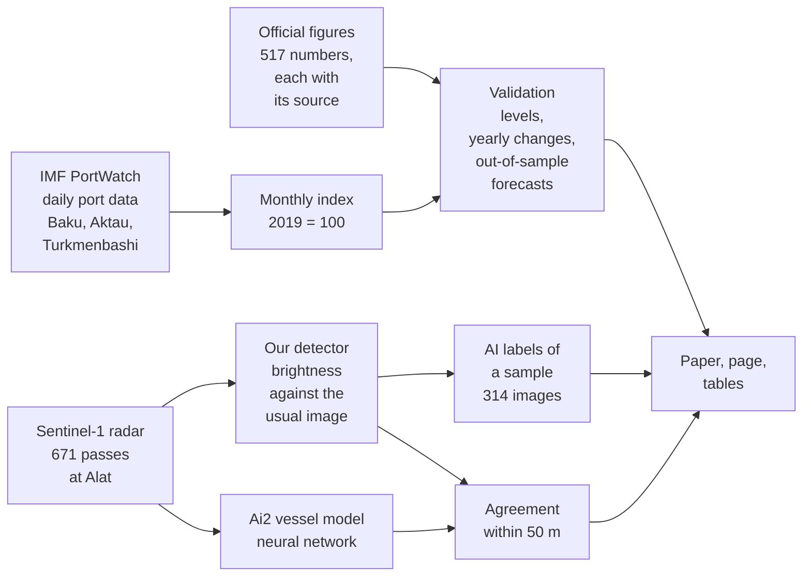
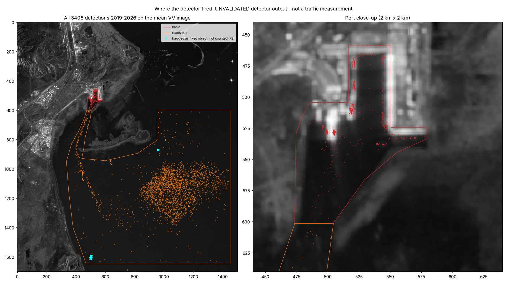
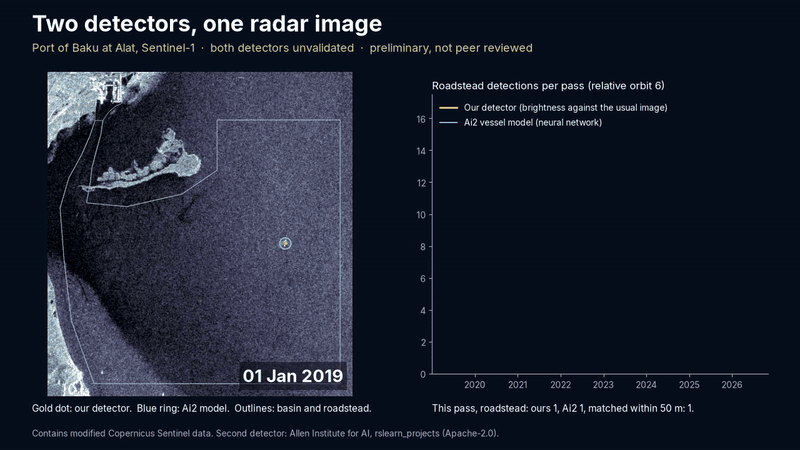

# Middle Corridor Monitor

**What open AIS-derived port data can and cannot say about cargo crossing the Caspian**

Aghasalim Mustafazada<sup>1</sup> and Teymur Eyvazov<sup>2</sup>

<sup>1</sup> Howest University of Applied Sciences, Belgium. <sup>2</sup> University of Massachusetts Boston, USA.

[Paper (PDF, 17 pages)](paper/latex/main.pdf) | [Project page](https://aghasalim.github.io/middle-corridor-monitor/) | [Where each number comes from](paper/NUMBERS.md) | [Reproduce](#reproducing-the-results) | [Cite](#citation)

Working paper, November 2026. Preliminary and not peer reviewed.


*Figure 1. One frame per month. Left: the mean Sentinel-1 radar image of the Port of Baku at Alat with that month's
radar detections. They are bright objects on the water, not confirmed ships. Right: the index up to that month.
Drawn by `research/video.py` from the data in this repository ([MP4](docs/monitor.mp4)).*

## Abstract

We build an open monthly index of cargo ship calls on the Caspian leg of the Middle Corridor from IMF PortWatch
daily port data for Baku, Aktau and Turkmenbashi (January 2019 to October 2026), and test it against official
statistics and Sentinel-1 radar. The results are mostly negative. The headline index of non-tanker port calls
does not track the route total published by the Kazakh Ministry of Transport: the year-on-year correlation is
-0.05 (n = 6). A monthly out-of-sample test on PortWatch tonnage at Aktau loses to two naive forecasts. PortWatch
matches official vessel-call levels and oil tonnage at Aktau, but not year-on-year changes in calls. Its dry
tonnage at Baku is about 12% of the official total. Ro-Ro calls rise about fourfold between 2021 and 2022.
Official ferry statistics for Kuryk show growth of 50% in calls and 87% in tonnes, not fourfold; the cause is not
confirmed. Kuryk, with 18% to 30% of Kazakh seaport cargo (one year is in doubt), is not in PortWatch. Sentinel-1
radar detections at Alat, labelled by an AI model and not checked by a person beyond a 10-image spot check, look
like vessels in the roadstead (131 of 132 decided) but mostly not in the harbour basin (7 of 34). An independent
open vessel-detection model finds 92% of our roadstead detections and almost nothing in the basin.

## Motivation

How much cargo crosses the Caspian Sea on the Middle Corridor? The official figures do not agree. For 2025 the
Kazakh Ministry of Transport reports 4.119 million tonnes on the route, and the route association's own chart
shows 1.867 million tonnes. The international reports we read take their volumes from operators, railways, port
authorities, surveys or models. None of them uses ship-tracking or satellite data, so the official figures have
no independent check. We test whether open data can provide one.

## Results

Every number below is from the paper. The file each one comes from is listed in `paper/NUMBERS.md`.

| Question | Result |
|---|---|
| Does the index follow the ministry's route total? | No. Year-on-year correlation -0.05 (n = 6). |
| Does PortWatch tonnage forecast Aktau's monthly cargo? | No. It loses to two naive forecasts. |
| Where does PortWatch agree with official data? | Vessel-call levels and oil tonnage at Aktau. Not year-on-year changes in calls. |
| How much dry cargo does it see at Baku? | About 12% of the official total. |
| Is the fourfold rise in Ro-Ro calls from 2021 to 2022 real? | Not on the evidence. Official ferry statistics for Kuryk show +50% in calls and +87% in tonnes. The cause is not confirmed. |
| What is missing? | Kuryk, with 18% to 30% of Kazakh seaport cargo (one year is in doubt), is not in PortWatch. |
| Does radar confirm the counts? | Not yet. 3,333 objects in 671 passes at Alat. By AI labels of a sample, 131 of 132 decided detections in the roadstead are vessels, but only 7 of 34 in the harbour basin. No person has checked the labels beyond a 10-image spot check. |



*Figure 2. Caspian non-tanker port calls (headline) and Ro-Ro calls, 2019 monthly mean = 100. Sources: Kpler;
UN Global Platform; IMF PortWatch (portwatch.imf.org).*



*Figure 3. Left: PortWatch divided by the official figure, by year, for four pairs of series. Right: year-on-year
change of the Kazakh ministry's route total (tonnes) and of the headline index; the correlation is -0.05 (n = 6).*



*Figure 4. Monthly Ro-Ro, general cargo and tanker calls at Baku, Aktau and Turkmenbashi, 2021 to 2023. The Ro-Ro
step appears at all three ports at once.*

## Method



**Index.** The headline series is the monthly count of non-tanker port calls (container, dry bulk, general cargo,
Ro-Ro) at Baku, Aktau and Turkmenbashi, indexed to the 2019 monthly mean = 100. Ro-Ro calls, tanker calls,
PortWatch dry tonnage and a Black Sea comparator (Poti and Batumi) are reported next to it. The index counts ship
calls, not cargo: a call by a large ship and a call by a small one count the same.

**Validation.** We compare PortWatch with 517 official figures for the Port of Baku, the Kazakh seaports and the
route, each stored with its source address. We compare levels and year-on-year changes, and run a monthly
out-of-sample forecast test against two naive forecasts (the same month a year earlier and the previous month).

**Radar.** For every Sentinel-1 pass over Alat from 2019 to 2026 our detector compares the image with a per-pixel
reference built from the passes of the same orbit, masks fixed objects, and counts what remains in two zones: the
harbour basin and the open roadstead. An AI model (Claude Opus 5.5) labelled a sample of 314 images without
seeing the detector's scores. As a second opinion we ran the Sentinel-1 vessel model of the Allen Institute for AI
on the same passes and matched its detections to ours within 50 m. Details are in `research/SAR_METHOD.md`.


*Figure 5. Counting zones at Alat: basin (red) and roadstead (orange). Left: mean Sentinel-1 VV image of one
relative orbit, all passes 2019 to 2026. Middle: the port close-up. Right: Sentinel-2 true colour, 1 September
2025, same close-up.*

## Radar at Alat



*Figure 6. All radar detections from 2019 to 2026 on the mean radar image, by counting zone.*


*Figure 7. Radar detections per pass over time, basin and roadstead.*

### Two detectors on the same images



*Figure 8. One frame per radar pass (relative orbit 6, every third pass). Left: the radar image of that pass. A
gold dot is a detection by our detector, a blue ring is one by the Ai2 model. Right: roadstead detections per
pass by each detector. Drawn by `research/video_detectors.py` ([MP4](docs/detectors.mp4)).*

| Zone | Our detector | Ai2 model | Ours matched within 50 m | Ai2's matched |
|---|---|---|---|---|
| Roadstead (open water) | 2,488 | 2,341 | 2,278 (92%) | 2,278 (97%) |
| Harbour basin (quays) | 845 | 23 | 24 (3%) | 23 |

In the roadstead the two detectors agree in every year (84% to 94% of ours matched) and their counts per pass
correlate at 0.98. At the quays the second model finds almost nothing, so it neither confirms nor replaces a
basin count. Both detectors read the same images, so agreement between them is not accuracy. The table per year
is `outputs/tables/sar_detector_agreement.csv`.

## Limitations

- Kuryk, Kazakhstan's ferry port, is not in PortWatch, so it is missing from the index.
- The boundary of PortWatch's "Baku Port" is not published. Whether it includes Alat is unknown.
- Ferry cargo is poorly captured. Rail ferries may not be classed as Ro-Ro, and PortWatch dry-cargo tonnage at
  Baku is several times below official figures.
- Ro-Ro calls step up four- to sixfold between 2021 and 2022 at all three Caspian ports at once. We cannot
  explain this (`outputs/tables/index_roro_step.csv`).
- The radar detections are labelled only by an AI model (`data/sar/model_labels.csv`,
  `outputs/tables/sar_label_eval.csv`). No person has checked the labels beyond a 10-image spot check. The blind
  check of a fixed random 50 images (`research/label_tool.py --check`) has not been done. Until it is, the counts
  are not a validated ship count.
- The index does not track the official route total year on year and does not forecast Kazakhstan's monthly
  sea-cargo series (`outputs/tables/validate_*.csv`).
- The samples are short: six year-on-year pairs for the route total.

## Repository layout

```
src/mcm/          index, validation, project page (python -m mcm.build)
src/mcm/sar/      radar detector (python -m mcm.sar.run)
research/         notes on sources and method, one-off checks, figure and video scripts
data/portwatch/   dated copy of the PortWatch download
data/official/    official figures, one row per number with its source
data/sar/         radar detections of both detectors, counting zones, AI labels
outputs/          tables (CSV) and figures (PNG) written by the build
paper/            paper source (LaTeX), PDF, and NUMBERS.md
docs/             project page and animations
tests/            unit tests
```

The radar image cache and the source PDFs of the official figures are not stored here.

## Reproducing the results

```
python -m venv .venv
.venv/Scripts/python -m pip install -r requirements.txt
.venv/Scripts/python -m pip install -e .
.venv/Scripts/python -m mcm.build            # downloads PortWatch, then builds everything
.venv/Scripts/python -m mcm.build --offline  # reuses data/portwatch/
.venv/Scripts/python -m pytest -q
.venv/Scripts/python research/paper_checks.py    # extra numbers quoted in the paper
.venv/Scripts/python research/paper_figures.py   # the two validation figures used in the paper
```

On macOS and Linux use `.venv/bin/python`. The build stops with an error if a port's download is short or has a
duplicated or missing day. The download date and the first and last day per port are in
`data/portwatch/snapshot.json`.

The paper is in `paper/latex/` (`main.tex`, `references.bib`, `figures/`). Build it with
`pdflatex main && bibtex main && pdflatex main && pdflatex main`. An earlier 8-page version is `paper/paper.md`
(`paper/build_pdf.py`, needs Chrome).

The second radar detector (`research/second_detector.py`, then `research/detector_agreement.py`) needs PyTorch,
`rslearn`, a clone of https://github.com/allenai/rslearn_projects (set `RSLEARN_PROJECTS` to its folder) and its
1.26 GB checkpoint; see `research/SECOND_DETECTOR_OPTIONS.md`. Its results are already in
`data/sar/detections_ai2.csv`.

The animations and the title image are rebuilt with `research/video.py`, `research/video_detectors.py` (both need
ffmpeg) and `research/banner.py`.

## Data

- IMF PortWatch daily port data (ArcGIS feature service `Daily_Ports_Data`), ports Baku (port100), Aktau (port16),
  Turkmenbashi (port1330), Poti (port1016) and Batumi (port127). Sources: Kpler; UN Global Platform; IMF PortWatch
  (portwatch.imf.org).
- Official figures for validation (Port of Baku, Kazakh seaports, the route) in
  `data/official/official_figures.csv`, each row with its source address and date.
- Sentinel-1 radar and Sentinel-2 optical images. They contain modified Copernicus Sentinel data.

All images in this repository are produced by its code from satellite or port-call data. None is an illustration.

## Author contributions

- Aghasalim Mustafazada (third-year bachelor student, Creative Technologies & AI, Howest): Sentinel-1 radar
  detection, labelling kit, project page, figures and animations.
- Teymur Eyvazov (University of Massachusetts Boston): index, statistics, validation against official figures.

Both authors are responsible for the paper.

## Citation

```bibtex
@misc{mustafazada2026middlecorridor,
  title        = {Middle Corridor Monitor: what open AIS-derived port data can and cannot say about cargo crossing the Caspian},
  author       = {Mustafazada, Aghasalim and Eyvazov, Teymur},
  year         = {2026},
  month        = nov,
  howpublished = {Working paper, not peer reviewed},
  url          = {https://github.com/aghasalim/middle-corridor-monitor}
}
```

## Acknowledgements

This work uses IMF PortWatch data (Kpler; UN Global Platform), Copernicus Sentinel data, and the Sentinel-1
vessel model from `rslearn_projects` by the Allen Institute for AI (Apache-2.0). How AI tools were used in the
code, the labels and the writing is stated in the paper under "Use of AI tools".

## Licence

- Code: MIT, see `LICENSE`.
- Text, figures, tables, animations and the paper: CC BY 4.0 (https://creativecommons.org/licenses/by/4.0/).
- Third-party data keep their own terms. `data/portwatch/` is a copy of public IMF PortWatch data and must be
  cited as: Sources: Kpler; UN Global Platform; IMF PortWatch (portwatch.imf.org). The figures in `data/official/`
  belong to the bodies that published them; each row gives its source.

Questions and corrections: please open an issue.
