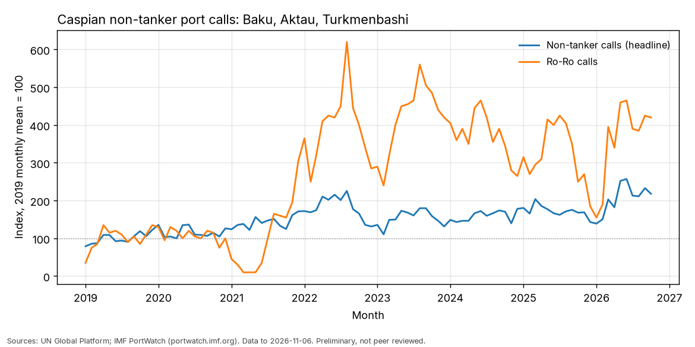
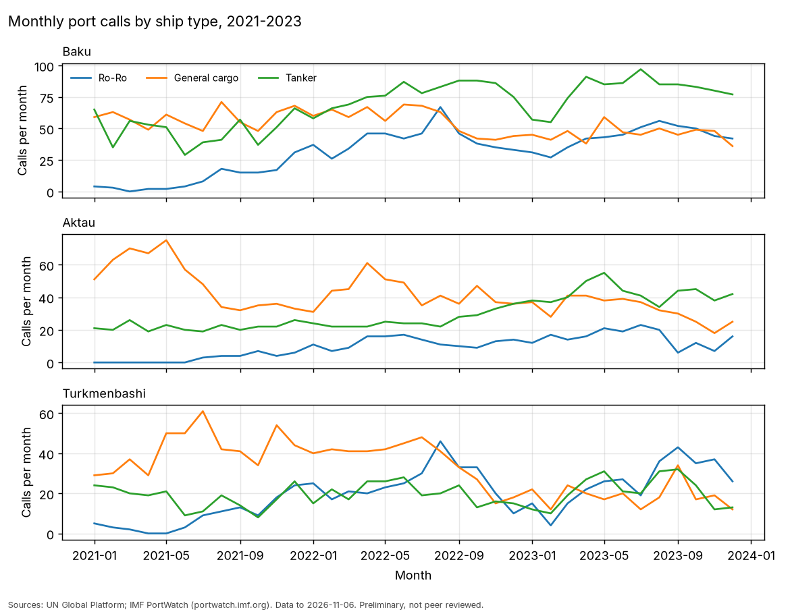
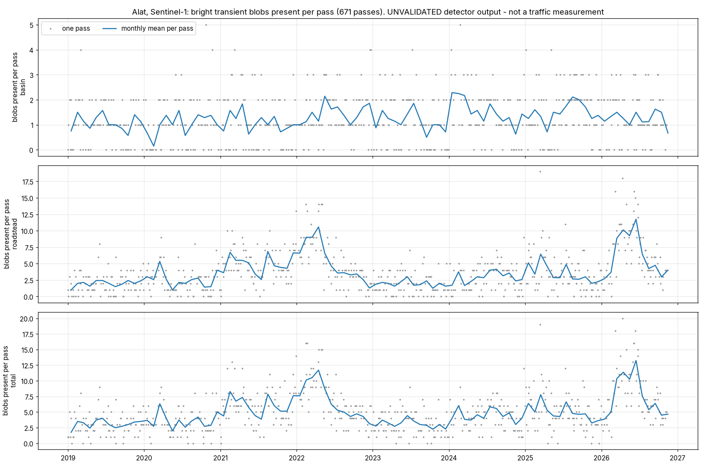

# Middle Corridor Monitor: what open AIS-derived port data can and cannot say about cargo crossing the Caspian

**Draft, not peer reviewed.**

Aghasalim Mustafazada (Howest University of Applied Sciences, Belgium; third-year bachelor student, Creative Technologies & AI) and Teymur Eyvazov (University of Massachusetts Boston, USA)

Working paper, version of 14 November 2026.

Sources: Kpler; UN Global Platform; IMF PortWatch (portwatch.imf.org).

## 1. Abstract

We build an open monthly index of cargo ship calls on the Caspian leg of the Middle Corridor from IMF PortWatch daily port data for Baku, Aktau and Turkmenbashi (January 2019 to October 2026), and test it against official statistics and Sentinel-1 radar. The results are mostly negative. The headline index of non-tanker port calls does not track the route total published by the Kazakh Ministry of Transport: the year-on-year correlation is -0.05 (n = 6). A monthly out-of-sample test on PortWatch tonnage at Aktau loses to two naive forecasts. PortWatch matches official vessel-call levels and oil tonnage at Aktau, but not year-on-year changes in calls. Its dry tonnage at Baku is about 12% of the official total. Ro-Ro calls rise about fourfold between 2021 and 2022. Official ferry statistics for Kuryk show growth of 50% in calls and 87% in tonnes, not fourfold; the cause is not confirmed. Kuryk, with 18% to 30% of Kazakh seaport cargo (one year is in doubt), is not in PortWatch. Sentinel-1 radar detections at Alat, labelled by an AI model and not yet checked by a person, look like vessels in the roadstead (131 of 132 decided) but mostly not in the harbour basin (7 of 34).

## 2. Introduction and question

The Middle Corridor carries freight between Central Asia and Europe across the Caspian Sea. Its sea leg links the Kazakh ports of Aktau and Kuryk, the Turkmen port of Turkmenbashi, and the Port of Baku at Alat in Azerbaijan. How much cargo crosses is not settled. For 2025 the Kazakh Ministry of Transport reports 4.119 million tonnes (Mt) on the route, while the route association's own chart shows 1.867 Mt [@titr2026chart]. The two series agree up to 2022 and part afterwards (2024: 4.484 Mt against 1.857 Mt), and the association's chart for 2024 is also below the 3.3 Mt in its own press release. For 2024 the association published 3.3 Mt and the ministry 4.484 Mt. Only the association's 2024 figure states a basis (via the seaports of Kazakhstan and Azerbaijan).

The World Bank, OECD, EBRD, ADB and CAREC reports that we read take their volumes from operators, the route association, railways and port authorities, or from surveys and models [@worldbank2023middle; @oecd2023realising; @oecd2025enhancing; @ebrd2023sustainable; @adb2024tradeflows; @carec2022cpmm; @carec2024cpmm]. We found no use of ship-tracking (AIS) or satellite data in any of them. So, in the reports we read, the official figures have no independent benchmark. The World Bank's September 2026 report uses no AIS or satellite data; its 8.8 Mt across the Caspian in 2023 comes from a trade and transport model [@worldbank2026integration] (read once, in a later research pass).

Port calls and draught changes from AIS have been turned into trade indicators for single countries and for the world [@arslanalp2019big; @cerdeiro2020world; @arslanalp2021tracking; @verschuur2021global; @lechthaler2022kiel; @stamer2024thinking]. IMF PortWatch publishes daily port calls and tonnage estimates per port from this work [@portwatch2026dailyports; @arslanalp2025nowcasting; @arslanalp2026nowcasting]. The Pacific island study explains 89% of the variation in official statistics [@arslanalp2021tracking], and the payload formula was validated for bulk carriers [@jia2019estimating] (abstract only read). We found no published validation for Ro-Ro ships or rail ferries. An ADB review notes that draught-based trade estimates "may not be more accurate than using port call information" [@adb2023ais].

Two recent works are closest to ours. The Black Sea-Middle Corridor Integration Index is an annual readiness index of eleven component indices over 19 port or route-year observations, and uses no AIS data [@gondauri2026bsmcii]. A 2026 policy brief reports author-compiled vessel counts for Caspian ports over a window in April 2026 without naming its data source [@wu2026caspianshock]. For radar, the global vessel map of Paolo et al. excludes water within 1 km of shore [@paolo2024satellite], and by our check of its published study area it does not cover the Caspian.

We found no open, documented, recurring AIS-based or radar-based measure of the Caspian leg. A later search of CyberLeninka in Russian found no such work. Google Scholar, eLIBRARY and RePEc could not be searched properly, so this holds less firmly for Russian-language work.

What we add is narrow. A monthly sum of PortWatch data is a re-aggregation, not a contribution in itself. The contribution is the check: a reproducible index, a file of 517 official figures, about half of which can be set against a PortWatch period, a first radar count at Alat, and a plain account of where each fails. We ask three questions.

1. Which official total does an AIS-based corridor index track?
2. How much traffic does AIS-based data miss?
3. Does the index predict the next official releases out of sample?

## 3. Data

### 3.1 PortWatch

We use the PortWatch `Daily_Ports_Data` service for five ports: Baku (port100), Aktau (port16), Turkmenbashi (port1330), and as a comparator the Black Sea ports Poti (port1016) and Batumi (port127). The download of 13 November 2026 holds 2,867 days per port, from 1 January 2019 to 6 November 2026.

PortWatch's dataset description defines a port call as a ship entering a port boundary; its FAQ says arrival at berth [@portwatch2026faq]. The exact rule and the port boundaries are not published. It drops calls with a turnaround under five hours and no change in draught. It reports five ship types: container, dry bulk, general cargo, Ro-Ro and tanker. Tonnage is estimated from the change in draught. The AIS data come through the UN Global Platform; the provider is named as exactEarth in the 2021 method paper, Spire in the dataset description and Kpler in the current FAQ [@portwatch2026dailyports; @arslanalp2021tracking; @portwatch2026faq].

Four exclusions matter here.

- Passenger ships are not one of the five types. The underlying method keeps only trade-carrying vessels [@verschuur2021global].
- Kuryk, Kazakhstan's ferry port, is not in the PortWatch port list.
- The port polygons are not published.
- "Baku Port" is the only Azerbaijani entry. Its point (40.2846 N, 49.7325 E) lies on the coast between Baku city and Alat, about 43 km from Alat by our rough estimate. Whether the Alat ferry terminal is inside the polygon is unknown. PortWatch tanker tonnage at "Baku Port" is 2.4 to 3.4 times the oil tonnage the Port of Baku reports for 2021, 2023 and 2024 (port rows not re-opened), which points to a wide area.

### 3.2 Official figures

The file `data/official/official_figures.csv` holds 517 published numbers with status, and with source address and date where known: 433 opened at the source, 77 carried over from earlier notes without being re-opened, and 7 seen only in search snippets.

No regular monthly series measures any of the four ports. The Port of Baku issues cumulative press releases at irregular intervals. The Kazakh port table (Aktau, Kuryk, the Aktau North Terminal or AMCT) is annual. The only single-month series is Kazakhstan's "cargo carried by sea transport". It counts cargo moved by Kazakh carriers, not cargo handled in ports, and most months of 2019 to 2022 are suppressed as confidential. Handled and carried tonnage differ widely: Azerbaijan in 2025 reports 12.96 Mt handled in seaports and 9.09 Mt carried by sea transport.

The official figures also contradict each other. Kazakh seaports in 2025 handled 7.453 Mt in the port table and 8 Mt in a press report. For the route total we use the Kazakh ministry series for 2019 to 2025, which has seven consecutive years. The association's chart series, found later, covers the same years and is far lower from 2023; it is not tested here. The rows of the ministry series were carried over from earlier notes and not re-opened.

### 3.3 Sentinel-1

The Copernicus catalogue lists 79 to 93 Sentinel-1 passes a year over Alat in 2019 to 2026, 53 to 63 over Aktau, 78 to 93 over Kuryk, and 106 to 122 over Turkmenbashi (2026 is a part year). All passes up to 2024 are from Sentinel-1A. In 2026, 34 of the 79 passes over Alat are from Sentinel-1D.

We processed Alat only. Images come from the Microsoft Planetary Computer copy of the ground-range product. It holds 672 of the 703 catalogue passes. The 31 missing passes (10 of them in 2024) were left out. One pass has partial coverage, so 671 are counted. The mean gap between counted passes is 4.3 days and the longest is 18.5 days. At that spacing the passes give snapshots of objects present, not arrivals or cargo.

## 4. Method

### 4.1 Index

For each day we sum port calls of the four non-tanker types at the three Caspian ports, then sum by calendar month, keeping only complete months. That gives 94 months, January 2019 to October 2026. The headline index is each month divided by the mean month of 2019, times 100. We report the same for Ro-Ro calls, tanker calls, PortWatch dry tonnage, and non-tanker calls at Poti plus Batumi.

The headline counts calls, not tonnes. Because it sums four ship types, it does not change if a ship moves from one of these types to another. It does change with AIS coverage, and when a ship enters or leaves the five types.

To date the Ro-Ro step we fit a single break in the mean, by least squares, to each port's monthly series for January 2021 to December 2023.

### 4.2 Validation design

The validation uses no estimates. A cumulative official release becomes an increment only by subtracting the previous release of the same year. A PortWatch value is computed only when PortWatch covers every day of the official period.

The annual comparison pairs eight official series with seven PortWatch measures, 56 pairs, for 2019 to 2025. Port of Baku figures are set against PortWatch Baku; Aktau, Aktau plus AMCT, and all Kazakh seaports against PortWatch Aktau; the route total against the three Caspian ports together. For each pair we report the mean ratio of PortWatch to official where units match, and Pearson and Spearman correlations of levels and of year-on-year changes. Levels have at most seven points and changes at most six.

The monthly test sets the Kazakh single-month series against PortWatch total tonnage at Aktau. For each month after the first 24 available months, we fit a line on all earlier months and forecast the official value from that month's PortWatch value. We compare its root mean squared error (RMSE) with two naive forecasts on the same months: the same month one year earlier, and the previous available month.

### 4.3 Radar detector

Each image is compared with the usual brightness of each pixel, taken as the 25th percentile over passes of the same orbit within a year either side. Pixels that are always bright (quays, cranes, land) are masked. A pixel is a candidate if it is at least 6 dB brighter than its reference, and touching candidates form a blob. Blobs under about 50 m or over 300 m are dropped. Blobs are counted in two zones: the harbour basin and the roadstead outside it. The roadstead zone was drawn before any detection was run. The masking threshold and a rule that removes fixed objects (73 blobs) were set after looking at first detections.

A labelling kit holds 186 detections (a worst-case margin of 7 percentage points) and 128 tiles where the detector found nothing. An AI model (Claude Opus 5.5) labelled all 314 image chips, seeing the images but not the detector's scores. No person has checked them beyond a 10-chip spot check.

## 5. Results

### 5.1 The index series

Non-tanker calls at the three ports rise from 1,442 in 2019 to 2,621 in 2022, fall to 2,215 in 2023 and reach 2,486 in 2025 (Table 1, Figure 1). The index averages 206 over January to October 2026. Its highest month is June 2026 with 309 calls (index 257).

**Table 1. PortWatch annual totals, Baku + Aktau + Turkmenbashi, and the Black Sea comparator.**

| Year | Non-tanker calls | Index (2019 = 100) | Ro-Ro calls | Tanker calls | Dry tonnage, Mt | Poti + Batumi non-tanker calls |
|---|---|---|---|---|---|---|
| 2019 | 1,442 | 100.0 | 240 | 1,070 | 1.24 | 1,122 |
| 2020 | 1,666 | 115.5 | 262 | 1,104 | 1.27 | 1,020 |
| 2021 | 2,051 | 142.2 | 244 | 1,052 | 1.73 | 847 |
| 2022 | 2,621 | 181.8 | 946 | 1,481 | 2.25 | 1,006 |
| 2023 | 2,215 | 153.6 | 1,006 | 1,715 | 1.84 | 991 |
| 2024 | 2,298 | 159.4 | 894 | 1,472 | 2.09 | 1,031 |
| 2025 | 2,486 | 172.4 | 778 | 1,293 | 2.28 | 1,114 |

*Figure 1. Caspian non-tanker port calls (headline) and Ro-Ro calls, 2019 monthly mean = 100. Sources: Kpler; UN Global Platform; IMF PortWatch (portwatch.imf.org).*

The Black Sea comparator shows no trend: Poti plus Batumi stay between 847 and 1,122 non-tanker calls a year, though they also rise by 19% in 2022, against 28% for the Caspian. That does not make the Caspian rise real growth. The whole rise between 2021 and 2022 comes from Ro-Ro calls: they rise by 702, while all non-tanker calls rise by 570. The other three types together fall by 132.

### 5.2 The Ro-Ro step of 2021-22

Ro-Ro calls at the three ports together rise about fourfold, from 244 in 2021 to 946 in 2022, and the step comes at Baku, Aktau and Turkmenbashi at once (Table 2, Figure 2). The fitted breaks fall within three months of each other: November 2021, December 2021 and January 2022. The mean after the break is 4.5 to 5.9 times the mean before it.

In January to June 2021 the three ports together record 28 Ro-Ro calls, and Aktau none. In July to December 2021 they record 216. So there is a trough in early 2021 and then a rise at all three ports from July 2021. The trough inflates the break ratios. Against 2019, the 2022 totals are about four times higher at each port. Poti shows the same trough: no Ro-Ro calls from December 2020 to March 2021, and 18 in 2021 against 42 in 2020 and 46 in 2022. So the early-2021 gap is not confined to the Caspian; the fourfold level afterwards is.

**Table 2. PortWatch Ro-Ro calls per year, and the fitted break in monthly calls (window January 2021 to December 2023).**

| Port | 2019 | 2020 | 2021 | 2022 | 2023 | Break month | Monthly mean before | Monthly mean after | Ratio |
|---|---|---|---|---|---|---|---|---|---|
| Baku | 126 | 131 | 119 | 496 | 518 | 2021-12 | 8.0 | 41.8 | 5.22 |
| Aktau | 36 | 35 | 28 | 147 | 183 | 2022-01 | 2.3 | 13.8 | 5.89 |
| Turkmenbashi | 78 | 96 | 97 | 303 | 305 | 2021-11 | 5.5 | 25.0 | 4.55 |
| All three | 240 | 262 | 244 | 946 | 1,006 | | | | |

*Figure 2. Monthly Ro-Ro, general cargo and tanker calls at each port, 2021 to 2023. Source as Figure 1.*

Official ferry statistics show growth, but no fourfold rise. From 2021 to 2022 Kuryk's ferry calls rose from 412 to 618 (+50%) and its cargo by 87%, while PortWatch Ro-Ro calls at the three ports rose by 288%. Over a longer span, the Port of Baku handled 44,175 rail wagons in 2019 and 37,300 in 2023, with 33,671 wheeled vehicles in 2019 and 54,200 trucks in 2023 (the Baku rows were carried over and not re-opened). Between 2019 and 2023 PortWatch Ro-Ro calls at Baku went from 126 to 518.

Four checks narrow the question without closing it.

- The step is not global. Summed over every PortWatch port, Ro-Ro calls were 103,762 in 2021 and 106,384 in 2022.
- General cargo calls also fall within 2021 to 2023 (ratios of 0.75, 0.59 and 0.46), but the breaks are September 2022 at Baku, July 2021 at Aktau and October 2022 at Turkmenbashi. Only at Aktau does the fall coincide with the return of Ro-Ro calls, so a reclassification of ships is possible there and not shown elsewhere.
- Among the 14 ferries we identified, none listed as a Ro-Ro cargo ship was built or delivered in 2021 or 2022. Several ferries remain unidentified.
- The Kazakh port table records 2 to 22 ferry calls a year at Aktau in 2019 to 2024. PortWatch records 28 to 183 Ro-Ro calls a year there. What PortWatch classes as Ro-Ro at Aktau is not what the port counts as ferries.

The cause of the step is not confirmed. A change in the AIS data feed for the Caspian, or in how certain ships are classified, is the leading explanation. Real growth is not. PortWatch's FAQ states that expanded AIS receiver coverage in November 2021 caused a sustained increase in recorded port calls at Gwangyang in Korea and in Malacca Strait transits [@portwatch2026faq]. It names no Caspian port. So coverage steps of this kind are documented in the data, but the timing here fits only partly: Ro-Ro calls at the three ports rise from 2 a month in March to May 2021 to 20 in July and 33 in August, before November, and reach 61 in December. All calls average 250 a month in January to October 2021 and 306 in November 2021 to February 2022. Global Fishing Watch reports that its own change of AIS vendor changed its data volume, and warns against comparing before and after [@gfw2026vendor]. Until this is settled, Ro-Ro calls before 2022 should not be compared with later ones.

### 5.3 Where PortWatch agrees with official data, and where it does not

**Table 3. PortWatch against official annual figures, 2019 to 2025. Ratio = PortWatch divided by official, mean over years. r = Pearson correlation; n in brackets.**

| Official series | PortWatch measure | Mean ratio | r, levels (n) | r, year-on-year (n) |
|---|---|---|---|---|
| Aktau + AMCT vessel calls | All calls, Aktau | 0.97 | 0.90 (7) | -0.16 (6) |
| Aktau vessel calls | All calls, Aktau | 1.28 | 0.87 (7) | -0.39 (6) |
| Aktau oil tonnes | Tanker tonnes, Aktau | 0.97 | 0.85 (6) | 0.89 (5) |
| Aktau oil tonnes | Tanker calls, Aktau | | 0.999 (6) | 0.99 (5) |
| Aktau total tonnes | All tonnes, Aktau | 0.82 | 0.75 (7) | 0.53 (6) |
| Aktau + AMCT total tonnes* | All tonnes, Aktau | 0.67 | 0.57 (7) | 0.16 (6) |
| Kazakh seaports total tonnes | All tonnes, Aktau | 0.51 | 0.81 (7) | 0.59 (6) |
| Port of Baku total tonnes | Dry tonnes, Baku | 0.12 | 0.90 (7) | 0.30 (6) |
| Port of Baku total tonnes | All tonnes, Baku | 0.77 | 0.66 (7) | 0.50 (6) |
| Route total (Kazakh ministry) | Non-tanker calls, three ports | | 0.60 (7) | -0.05 (6) |
| Route total (Kazakh ministry) | Ro-Ro calls, three ports | | 0.73 (7) | 0.79 (6) |
| Route total (Kazakh ministry) | Tanker calls, three ports | | 0.60 (7) | 0.80 (6) |

*\* With the 2020 Kuryk and AMCT tonnages exchanged (section 5.6): 0.69, 0.65 (7), 0.20 (6).*

**Agreement.** Vessel calls at Aktau match when the separate AMCT terminal is added to the port company's count (Table 3). PortWatch records 1,383 calls in 2025 against 1,394 official. The ratio is between 0.98 and 1.04 in six of seven years; the exception is 2020, with 748 against 983. This suggests that the PortWatch polygon for Aktau includes AMCT, which we cannot confirm. The year-on-year changes do not correlate, so the agreement is in level only. Adding AMCT improves the match for calls and worsens it for tonnage (0.67 against 0.82).

Oil at Aktau also matches. PortWatch tanker tonnage is between 0.97 and 1.08 of the port's oil tonnage in 2019 to 2023, and 0.77 in 2024. Tanker calls follow oil tonnage more closely than any other pair, in levels and in year-on-year changes.

**Disagreement.** PortWatch total tonnage at Aktau is 0.82 of the official total on average and 0.71 in 2025. Against all Kazakh seaports, PortWatch at Aktau sees about half the tonnage, because Kuryk and other terminals are outside it.

At Baku, PortWatch dry tonnage is 12% of the port's official total on average (six of the seven port totals were not re-opened). The ratio for all tonnage looks better (0.77), but for the wrong reason: PortWatch tanker tonnage is far above the port's own oil figure (section 3.1), while ferry cargo is largely missing. The World Bank reports that of 6.3 Mt handled at Alat in 2022, 2.5 Mt moved on railcars and 1.1 Mt in trucks and trailers [@worldbank2023middle]. PortWatch shows 1.03 Mt of dry cargo at Baku that year. For 2024 the port reports 1.044 Mt of "dry cargo" as a separate item, and PortWatch dry tonnage is 1.00 Mt (row not re-opened). For January to September 2026 the port reports 1.73 Mt and PortWatch shows 1.02 Mt, a ratio of 0.59. So the reading that PortWatch sees conventional dry cargo at Baku and misses only ferry cargo holds in one of the two periods available. It is not established.

### 5.4 Question 1: which official total does the index track?

None closely. Against the Kazakh ministry's route total, the headline index has a level correlation of 0.60 (n = 7) and a year-on-year correlation of -0.05 (n = 6). The route total rose by 153% in 2022 and 86% in 2023. Non-tanker calls rose by 28% and then fell by 15%.

Two PortWatch measures do correlate with the route total year on year: Ro-Ro calls (0.79) and tanker calls (0.80), both with n = 6. We rely on neither. Both rest on 2022, the year of the suspect step: without that year's change the correlations are 0.27 and 0.42 (n = 5), and the headline's is -0.90. Both are also among 56 pairs tested on five or six points, so some high values are expected by chance.

What the index does follow is weaker and more local. Non-tanker calls at Baku rise with the Port of Baku's total tonnage in levels (0.88, n = 7), which mostly reflects two rising series; year on year the correlation is 0.30. The parts of PortWatch that agree with official data are outside the headline index: tanker activity and total call counts at Aktau.

### 5.5 Question 3: does the index predict official releases out of sample?

No. The monthly test covers the 54 months between February 2019 and October 2026 for which Kazakhstan publishes a single-month figure. Over these months the level correlation between PortWatch tonnage at Aktau and the official series is 0.06. The year-on-year correlation is -0.23 (n = 34).

The out-of-sample test has 30 months, May 2024 to October 2026. The RMSE is 144.1 thousand tonnes for the PortWatch regression, 104.1 thousand tonnes for the same month a year earlier, and 54.9 thousand tonnes for the previous available month. The PortWatch forecast is below the official value in all 30 months.

The target is a poor match. It counts cargo carried by Kazakh carriers wherever it is loaded, not cargo handled at Aktau. Only 10 of the 48 months of 2019 to 2022 are published, so the regression starts from few early points. The official series also changes level: its monthly values are 34 to 90 thousand tonnes in 2019 and 228 to 467 thousand tonnes in 2025. PortWatch tonnage at Aktau shows no such rise.

So the test fails. It cannot tell us whether PortWatch would predict a port-based monthly series, because none exists for these ports.

### 5.6 Question 2: how much does AIS-based data miss?

We cannot give one number. Beyond the ferry cargo missing at Baku (section 5.3), we can name two gaps, and say why the radar check does not yet measure them.

**Kuryk.** In the Kazakh port table Kuryk handles 18% to 30% of all Kazakh seaport cargo in 2019 to 2025 and receives 412 to 700 ferry calls a year in 2019 to 2024 (Table 4). The 2020 share is 12.5% as published, but the 2020 tonnages for Kuryk and AMCT appear transposed in the source table. Ferry cargo for all Kazakh ports equals Kuryk's tonnage within 0.5% in every other year and equals AMCT's in 2020, and an Aktau port report gives AMCT 667 kt for 2020. Read that way the 2020 share is 29.2%. A second document supports this: the Aktau port's strategy for 2022 to 2032 gives Kuryk 1,560 kt and the North Terminal 667 kt in a table whose other rows carry 2020 values, though its caption says 2021 [@aktau2022strategy]. It may draw on the same administration data, so it is not independent proof. The World Bank describes Kuryk's cargo as mainly trucks and rail wagons on the route to Baku [@worldbank2023middle]. Yet in 2019 to 2021 PortWatch records only 119 to 131 Ro-Ro calls a year at Baku, well below the ferry calls that Kuryk alone reports.

**Table 4. Kuryk in the Kazakh port table, and PortWatch Ro-Ro calls.**

| Year | Kuryk cargo, kt | Kazakh seaports, kt | Kuryk share | Kuryk ferry calls | PortWatch Ro-Ro calls, Baku | PortWatch Ro-Ro calls, three ports |
|---|---|---|---|---|---|---|
| 2019 | 1,369.8 | 5,895.0 | 23.2% | 487 | 126 | 240 |
| 2020 | 666.8* | 5,338.8 | 12.5%* | 542 | 131 | 262 |
| 2021 | 974.5 | 5,456.2 | 17.9% | 412 | 119 | 244 |
| 2022 | 1,824.0 | 6,493.6 | 28.1% | 618 | 496 | 946 |
| 2023 | 2,115.0 | 7,168.0 | 29.5% | 700 | 518 | 1,006 |
| 2024 | 1,931.9 | 7,333.1 | 26.3% | 645 | 479 | 894 |
| 2025 | 1,719.0 | 7,453.0 | 23.1% | not published | 410 | 778 |

*\* As published. If Kuryk and AMCT are transposed in 2020: 1,560.1 kt and 29.2%.*

**Ferries that broadcast as passenger ships.** We identified 14 Caspian ferries on public vessel-tracking pages (listed in `research/FERRY_FLEET.md`). Eight are listed on VesselFinder as "Passenger/Ro-Ro Cargo Ship", and five of those broadcast the AIS type "Passenger ship". Six are listed as "Ro-Ro Cargo Ship", and five of those broadcast "Cargo ship". The World Bank counts 15 rail ferries, 2 Ro-Ro ships and 2 Ro-Pax ships in the fleet of the Azerbaijan Caspian Shipping Company alone [@worldbank2023middle], and 12 of our 14 are attributed to that fleet (operator assumed for three), so our list is incomplete. A later search found two more ships of that company (Mingachevir, listed as Ro-Ro cargo, and Ordubad, passenger/Ro-Ro); they are not in these counts. PortWatch has no passenger category, so the passenger/Ro-Ro ferries are likely outside its Ro-Ro count. Which field PortWatch classifies by is not documented, so this is unverified.

**Radar at Alat.** The detector counted 3,333 objects in 671 passes: 845 in the basin and 2,488 in the roadstead (Table 5, Figure 3). By the unchecked AI labels (section 4.3), 131 of the 132 decided roadstead detections are vessels (99%, 95% interval 96% to 99.9%; 6 unsure), but only 7 of 34 in the basin (21%, 10% to 37%; 14 unsure), where most sit on piers and quays. Tiles without a detection held no vessel in the roadstead (0 of 64) and a clear one in 2 of 64 in the basin (5 more possible). The roadstead count is thus close to a vessel count; the basin count is not.

**Table 5. Sentinel-1 detections per counted pass at Alat, and PortWatch calls at "Baku Port".**

| Year | Counted passes | Basin, mean per pass | Roadstead, mean per pass | Total, mean per pass | PortWatch calls, all types |
|---|---|---|---|---|---|
| 2019 | 83 | 1.07 | 1.98 | 3.05 | 1,044 |
| 2020 | 81 | 1.04 | 2.51 | 3.54 | 1,217 |
| 2021 | 86 | 1.08 | 4.95 | 6.03 | 1,399 |
| 2022 | 84 | 1.46 | 5.29 | 6.75 | 2,136 |
| 2023 | 86 | 1.12 | 1.97 | 3.08 | 2,036 |
| 2024 | 80 | 1.50 | 2.89 | 4.39 | 1,897 |
| 2025 | 92 | 1.51 | 3.59 | 5.10 | 1,815 |
| 2026 | 79 (to 10 Nov) | 1.28 | 6.59 | 7.87 | 1,983 (Jan to Oct) |

*Figure 3. Bright transient blobs per Sentinel-1 pass at Alat, by zone. Unvalidated detector output, not a traffic measurement.*

The roadstead count does not follow sea state (Spearman -0.08 and -0.03 for the two polarisations, n = 671). The basin count rises slightly with it (+0.12 and +0.14). In the basin a ship alongside a quay mostly merges with the quay, so the basin count is not the number of ships in port. In 2026 the Sentinel-1A passes (January to June) average 7.9 roadstead blobs and the Sentinel-1D passes (from 25 June) 4.9. Only one Sentinel-1A pass falls after the first Sentinel-1D pass, so a sensor effect cannot be tested. Sentinel-1A's own monthly mean rose from 2.7 in January to 11.7 in June, so at least part of the difference is a change over time.

Month by month over 94 months, the total blob count per pass correlates with PortWatch calls at "Baku Port" at 0.41 for all calls, 0.53 for non-tanker calls, 0.23 for Ro-Ro calls and 0.14 for tanker calls. We report this only as a weak aggregate comparison. The blobs are labelled only by an AI model and the basin blobs are mostly not ships, the two areas differ, and one series counts objects present while the other counts calls. The yearly shapes also differ: the roadstead mean falls from 5.29 in 2022 to 1.97 in 2023, while PortWatch calls barely change (2,136 and 2,036).

## 6. Limits

- **Unpublished polygons.** Every port comparison assumes areas we cannot see, including whether Alat lies inside "Baku Port".
- **The Ro-Ro break.** Ro-Ro calls before and after the 2021-22 step are not comparable, the cause is not confirmed, and the headline index inherits this.
- **Missing traffic.** Kuryk is not in the index. Eight of the 14 identified ferries are listed as passenger/Ro-Ro ships and may be outside PortWatch (unverified).
- **Short samples.** Annual correlations rest on n of 5 to 7, the two that look good depend on one year, and 56 pairs were tested.
- **Radar.** Labels are from an AI model, not checked by a person, and weak in the basin (ships at quays). Alat only, a platform change in 2026, and passes missing at the source unevenly by year.
- **Official series.** They contradict each other, mix handled and carried cargo and use different port definitions. One pair of 2020 figures appears transposed. Turkmenbashi has one official year: in 2025 PortWatch tonnage there is 9% of the official total.
- **Revisions and search.** PortWatch adds ports and refines boundaries [@arslanalp2026nowcasting]; our results describe the download of 13 November 2026. No proper pass through Google Scholar, eLIBRARY or RePEc was possible.

## 7. What would make this work

- **A human check of the radar labels.** A person labels a fixed random 50 chips blind; agreement decides whether the AI labels stand.
- **Answers from PortWatch.** The polygons for Baku and Aktau, the mapping from ship types to the five categories, and whether the AIS feed for the Caspian changed in 2021 or 2022. Nothing has been sent yet.
- **Differenced official releases.** Collecting each cumulative Port of Baku and Azerbaijani seaport release and differencing consecutive ones would, in time, give the port-based target that the present test lacks.
- **Kuryk from radar.** Kuryk has about as many Sentinel-1 passes as Alat, so a labelled detector could observe the port that AIS-based data leave out.

Until at least the first two exist, the index should be read as a count of PortWatch port calls, not as a measure of corridor cargo.

## 8. Data and code availability, and use of AI tools

**Data and code.** All code, the official figures file with its source addresses, the output tables and the figures are in a public repository, https://github.com/aghasalim/middle-corridor-monitor (code under the MIT licence; text, figures and tables under CC BY 4.0). `python -m mcm.build` rebuilds the index and validation tables from a fresh PortWatch download. Every number in this paper is traced to a file in `paper/NUMBERS.md`.

**Use of AI tools.** Code, literature search and drafting were done with an AI coding assistant (Claude, Anthropic) under the authors' direction. The radar sample was labelled by an AI model (section 4.3). The authors are responsible for the content. The numbers can be recomputed from the repository, except that the source PDFs of the official figures, the radar image cache and the vessel-tracking pages are not stored in it. This statement follows the disclosure policies of arXiv and SSRN [@arxiv2023genai; @ssrn2026genai].

## References

"Abstract only" means the full text was not opened.

- [@adb2023ais] Kim, Kijin; Basu Das, Sanchita; Pundit, Madhavi; Magnata, Paolo; Mariasingham, Mahinthan; Chico, Cherryl (2023). Economic Applicability of the Automatic Identification System Data: Use Cases and the Way Forward. ADB Briefs 244. Asian Development Bank. doi:10.22617/BRF230082-2
- [@adb2024tradeflows] Asian Development Bank (2024). Trade Flows and Transport Routes in the CAREC Region Amid External Shocks. CAREC Senior Officials' Meeting paper. Asian Development Bank. https://carecprogram.org/uploads/ADB-Middle-Corridor-Paper-ENG_Final-SOM2024.pdf
- [@arslanalp2019big] Arslanalp, Serkan; Marini, Marco; Tumbarello, Patrizia (2019). Big Data on Vessel Traffic: Nowcasting Trade Flows in Real Time. IMF Working Paper 19/275. International Monetary Fund. doi:10.5089/9781513521121.001
- [@arslanalp2021tracking] Arslanalp, Serkan; Koepke, Robin; Verschuur, Jasper (2021). Tracking Trade from Space: An Application to Pacific Island Countries. IMF Working Paper 21/225. International Monetary Fund. doi:10.5089/9781513593531.001
- [@arslanalp2025nowcasting] Arslanalp, Serkan; Choi, Seung Mo; Kamali, Parisa; Koepke, Robin; McKetty, Matthew; Ruta, Michele; Saraiva, Mario; Sozzi, Alessandra; Verschuur, Jasper (2025). Nowcasting Global Trade from Space. IMF Working Paper 25/93. International Monetary Fund. doi:10.5089/9798229009294.001
- [@arslanalp2026nowcasting] Arslanalp, Serkan; Exton, Oliver; Gao, Chang; Saraiva, Mario; Kamali, Parisa; Sozzi, Alessandra; Verschuur, Jasper (2026). Nowcasting Country-Level Trade Estimates Using IMF PortWatch. IMF Working Paper 26/99. International Monetary Fund. doi:10.5089/9798229046893.001
- [@arxiv2023genai] arXiv (2023). arXiv announces new policy on ChatGPT and similar tools. arXiv blog. https://blog.arxiv.org/2023/01/31/arxiv-announces-new-policy-on-chatgpt-and-similar-tools
- [@carec2022cpmm] CAREC Secretariat (2022). CAREC Corridor Performance Measurement and Monitoring Annual Report 2022. CAREC Program. https://cpmm.carecprogram.org/uploads/CPMM_Annual_Report_2022.pdf
- [@carec2024cpmm] CAREC Secretariat; CAREC Institute (2024). CAREC Corridor Performance Measurement and Monitoring Annual Report 2024. CAREC Program and CAREC Institute (file released July 2026). https://www.carecinstitute.org/wp-content/uploads/2026/07/CPMM-Annual-Report-2024_8th.pdf
- [@cerdeiro2020world] Cerdeiro, Diego; Komaromi, Andras; Liu, Yang; Saeed, Mamoon (2020). World Seaborne Trade in Real Time: A Proof of Concept for Building AIS-based Nowcasts from Scratch. IMF Working Paper 20/57. International Monetary Fund. doi:10.5089/9781513544106.001
- [@ebrd2023sustainable] European Bank for Reconstruction and Development (2023). Sustainable transport connections between Europe and Central Asia. EBRD. https://transport.ec.europa.eu/document/download/4360ea36-a75a-47e5-8b6f-84a9bde66a02_en?filename=Sustainable_transport_connections_between_Europe_and_Central_Asia.pdf
- [@gfw2026vendor] Global Fishing Watch (2026). Data vendor transition. Platform update. https://globalfishingwatch.org/platform-update/data-vendor-transition/
- [@gondauri2026bsmcii] Gondauri, Davit; Guramishvili, Guram (2026). Black Sea-Middle Corridor Integration Index (BSMCII): Dataset, Component Indices, Econometric Panel, and Replication Package for Measuring Multimodal Corridor Readiness. Zenodo. doi:10.5281/zenodo.21282793
- [@jia2019estimating] Jia, Haiying; Prakash, Vishnu; Smith, Tristan (2019). Estimating vessel payloads in bulk shipping using AIS data. International Journal of Shipping and Transport Logistics 11(1), 25-40. doi:10.1504/IJSTL.2019.096864. Abstract only (publisher landing page); full text not opened.
- [@lechthaler2022kiel] Lechthaler, Wolfgang; Stamer, Vincent (2022). The Kiel Trade Indicator - A real-time indicator for trade flows. SUERF Policy Brief 418. SUERF - The European Money and Finance Forum. https://www.suerf.org/publications/suerf-policy-notes-and-briefs/the-kiel-trade-indicator-a-real-time-indicator-for-trade-flows
- [@oecd2023realising] OECD (2023). Realising the Potential of the Middle Corridor. OECD Publishing, Paris. doi:10.1787/635ad854-en
- [@oecd2025enhancing] OECD (2025). Enhancing the Competitiveness of the Trans-Caspian Transport Corridor in Central Asia. OECD Publishing, Paris. doi:10.1787/f261e7fa-en
- [@paolo2024satellite] Paolo, Fernando S.; Kroodsma, David; Raynor, Jennifer; Hochberg, Tim; Davis, Pete; Cleary, Jesse; Marsaglia, Luca; Orofino, Sara; Thomas, Christian; Halpin, Patrick (2024). Satellite mapping reveals extensive industrial activity at sea. Nature 625, 85-91. doi:10.1038/s41586-023-06825-8
- [@portwatch2026dailyports] IMF PortWatch. Daily_Ports_Data (ArcGIS item description and dataset). ArcGIS Online item 83b1bbc7b3354c5fb1f40673bb8f852e. https://www.arcgis.com/home/item.html?id=83b1bbc7b3354c5fb1f40673bb8f852e. Sources: Kpler; UN Global Platform; IMF PortWatch (portwatch.imf.org). Accessed 13 Nov 2026.
- [@portwatch2026faq] IMF PortWatch. Frequently asked questions (ArcGIS item 640b69a4a96f41a6937cb4d2984f26da, modified 21 October 2026). https://portwatch.imf.org/pages/faqs (opened 14 November 2026)
- [@ssrn2026genai] SSRN (2026). What is SSRN's Policy on the Use of Generative AI by Authors? Elsevier Support Center. https://www.elsevier.support/ssrn/answer/AI
- [@stamer2024thinking] Stamer, Vincent (2024). Thinking outside the container: A sparse partial least squares approach to forecasting trade flows. International Journal of Forecasting 40(4), 1336-1358. doi:10.1016/j.ijforecast.2023.11.007. Abstract only (OpenAlex); full text not opened.
- [@verschuur2021global] Verschuur, Jasper; Koks, Elco E.; Hall, Jim W. (2021). Global economic impacts of COVID-19 lockdown measures stand out in high-frequency shipping data. PLoS ONE 16(4), e0248818. doi:10.1371/journal.pone.0248818
- [@worldbank2023middle] World Bank (2023). Middle Trade and Transport Corridor: Policies and Investments to Triple Freight Volumes and Halve Travel Time by 2030. World Bank, Washington, DC. https://openknowledge.worldbank.org/handle/10986/40626
- [@worldbank2026integration] World Bank (2026). Integration: World-Class Trade Logistics Along the Trans-Caspian Transport Corridor. World Bank, Washington, DC. https://www.worldbank.org/en/region/eca/publication/world-class-trade-logistics-along-trans-caspian-transport-corridor (opened 14 November 2026)
- [@titr2026chart] TITR International Association. Transportation volume via TITR, thousand tons (home-page chart, values read from the image). https://middlecorridor.com/en/ (opened 14 November 2026)
- [@aktau2022strategy] Aktau International Sea Trade Port (2022). Development strategy 2022 to 2032, p. 7 (in Russian). https://portaktau.kz/wp-content/uploads/2026/02/strategiya-razvitiya-amtp-2022-2032.pdf (opened 14 November 2026)
- [@wu2026caspianshock] Wu, Shaoyuan (2026). Caspian Logistics Shock: Monitoring Russia-Iran Supply Stress after the Anzali Strike: Visible Vessel Contraction, Port-Rhythm Inversion, and Window-Based Logistics in the Caspian Corridor. EPINOVA Policy Brief EPINOVA-2026-PB-44. EPINOVA LLC. doi:10.67037/epinova.pb.2026.044
